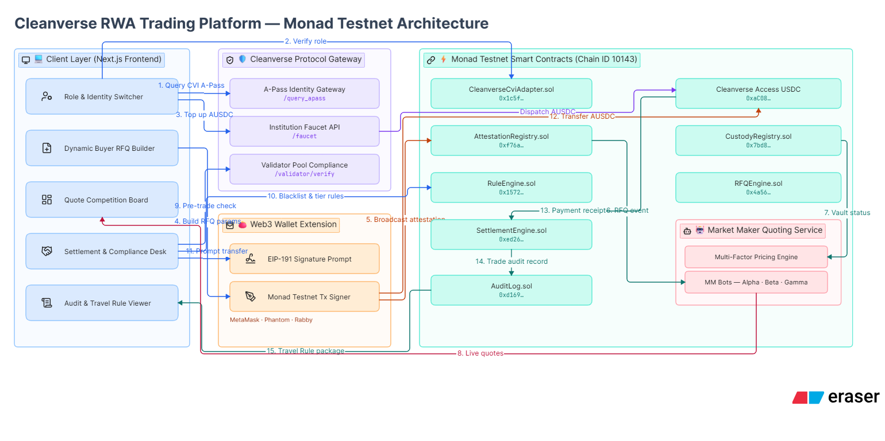
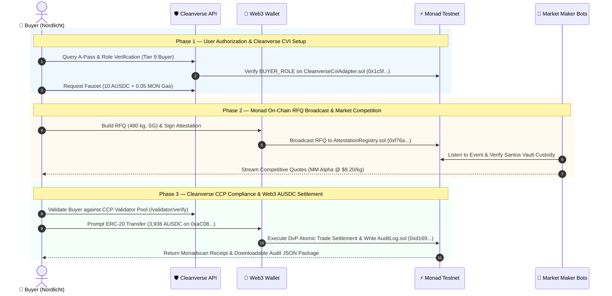

# ☕ BeanForQuote (CoffeeRFQ)

**Compliant Price Discovery & RFQ Settlement Layer for Tokenized Physical Commodity RWAs on Monad**

*Cleanverse Build: Trusted Assets Hackathon — RWA Track*

---

## ☕ Project Summary

**BeanForQuote (CoffeeRFQ)** is an institutional Request-for-Quote (RFQ) and settlement workspace for tokenized real-world physical commodity lots (coffee) deployed on **Monad Testnet** (Chain ID `10143`).

Instead of relying on illiquid AMM bonding curves that suffer from high slippage and lack regulatory oversight for long-tail commodities, BeanForQuote connects **Cleanverse CVI A-Pass verified exporters and roasters** directly with **accredited market makers**. 

Trades are quoted via multi-factor pricing (cupping score, physical warehouse receipts, lot scarcity, settlement latency), cleared pre-trade through **Cleanverse CCP Validator Pools**, settled atomically in **Cleanverse Access USDC (AUSDC)**, and recorded to **`AuditLog.sol`** with FATF Travel Rule cryptographic audit packages.

---

## 🚨 The Problem


Global physical coffee trading represents over **$200B in annual volume**, yet the supply chain remains plagued by manual friction:
- **Shallow AMMs fail physical RWAs:** Standard AMM liquidity pools cause severe price impact on high-value, long-tail physical commodities.
- **Opacity & Counterparty Risk:** Buyers lack real-time visibility into physical warehouse custody and quality attestation.
- **Compliance Friction:** Traditional cross-border commodity settlement takes 3–5 business days with heavy correspondent banking fees and manual KYC/Travel Rule reporting.

---

## 🏛️ System Architecture



The BeanForQuote architecture consists of 5 tightly integrated subsystem blocks:

1. **💻 Client Layer (Next.js 15 Frontend):** Role switcher (`Buyer` / `Exporter`), Dynamic RFQ Request Builder, Quote Competition Board, Settlement Desk, and Audit History Viewer.
2. **🛡️ Cleanverse Protocol Gateway:** A-Pass Identity Gateway (`/query_apass`), Institution Faucet API (`/faucet`), and Validator Pool Compliance (`/validator/verify`).
3. **👛 Web3 Wallet Extension:** MetaMask, Phantom, and Rabby support for EIP-191 payload signatures and Monad Testnet transaction signing.
4. **⚡ Monad Testnet Smart Contracts (Chain ID 10143):** 10 deployed EVM contracts managing identity, warehouse receipts, multi-factor quotes, rule enforcement, and atomic settlement.
5. **🤖 Market Maker Quoting Service:** Automated liquidity bots listening to on-chain RFQ attestation events and generating multi-factor competitive pricing.

---

## 🔄 End-to-End Sequence Flow


### The 3 Trade Execution Phases



---

## 🛡️ Detailed Cleanverse Integration

Cleanverse identity and payment rules are mechanics-driven throughout the trade lifecycle:

| Module | Implementation | Contract / Endpoint | Purpose |
|---|---|---|---|
| **Cleanverse CVI** | Verified Identity | `CleanverseCviAdapter.sol` (`0x1c5f...`) | Enforces `hasRole` permissions and checks freeze status on-chain. |
| **Cleanverse CVA** | Access USDC Token | `Cleanverse Access USDC` (`0xaC08...`) | Payment token (`AUSDC`, 6 decimals) used for all trade settlement transfers. |
| **Cleanverse Faucet** | Corporate Faucet API | `POST /faucet` | Dispatches 10 AUSDC testnet tokens and 0.05 MON native gas to registered wallets. |
| **Cleanverse CCP** | Validator Compliance | `POST /validator/verify` | Real-time Central Counterparty (CCP) validator check verifying A-Pass and Travel Rule status. |
| **Travel Rule Audit** | Cryptographic Export | `AuditLog.sol` (`0xd169...`) | Stores immutable post-trade records containing Travel Rule reference hashes (`TR-88391`). |

---

## 🚀 Deployed Smart Contracts (Monad Testnet — Chain ID `10143`)

All contracts are deployed, initialized, and linked live on the Monad Testnet:

| Contract | Address | Description |
|---|---|---|
| **`CleanverseCviAdapter`** | [`0x1c5fa313efc3868e0396532f92c163c02c148d6d`](https://testnet.monadscan.com/address/0x1c5fa313efc3868e0396532f92c163c02c148d6d) | CVI adapter verifying Cleanverse A-Pass NFT on-chain ownership & role gating |
| **`Cleanverse Access USDC (AUSDC)`** | [`0xaC0893567D43C3E7e6e35a72803df05416C1f20D`](https://testnet.monadscan.com/address/0xaC0893567D43C3E7e6e35a72803df05416C1f20D) | Cleanverse Access USDC ERC-20 payment token used for trade settlement |
| **`MockCleanverseCVA`** | [`0xcfb4dd97d787c8818247ff4a77fe31208abfdc3a`](https://testnet.monadscan.com/address/0xcfb4dd97d787c8818247ff4a77fe31208abfdc3a) | CVA wrapper managing compliant asset tokenization & transfer eligibility checks |
| **`AttestationRegistry`** | [`0xf76a2decdd3dca42c6f95d5c3148c6e2accd42c4`](https://testnet.monadscan.com/address/0xf76a2decdd3dca42c6f95d5c3148c6e2accd42c4) | On-chain registry storing RFQ broadcasts, cupping, and grade attestations |
| **`CustodyRegistry`** | [`0x7bd85132c3befaefca9b4b870073453714dfa362`](https://testnet.monadscan.com/address/0x7bd85132c3befaefca9b4b870073453714dfa362) | On-chain registry tracking physical custody transitions per coffee lot (Santos Vault) |
| **`RuleEngine`** | [`0x157209a3bc4100723e0d302f6163f1ec410bae66`](https://testnet.monadscan.com/address/0x157209a3bc4100723e0d302f6163f1ec410bae66) | Regulator jurisdiction rules, wallet flags, and lot freeze enforcement |
| **`CoffeeLotToken`** | [`0xab06536d0f182db3c54f6e1d7503d5ddd489dc84`](https://testnet.monadscan.com/address/0xab06536d0f182db3c54f6e1d7503d5ddd489dc84) | CVA-wrapped coffee lot token with metadata & dual-checkpoint compliance checks |
| **`AuditLog`** | [`0xd169c004f7a20fdba82dafd15c3e2c080f3b92a8`](https://testnet.monadscan.com/address/0xd169c004f7a20fdba82dafd15c3e2c080f3b92a8) | Immutable trade settlement history with Travel Rule data recording |
| **`SettlementEngine`** | [`0xed26a56ab4daf8f5a36a039e179ed4938fc976e8`](https://testnet.monadscan.com/address/0xed26a56ab4daf8f5a36a039e179ed4938fc976e8) | Atomic trade settlement engine (coffee lot token ↔ stablecoin) |
| **`RFQEngine`** | [`0x4a56d24fbb25769f1c2e9aaef0d2d756a2a5fa6e`](https://testnet.monadscan.com/address/0x4a56d24fbb25769f1c2e9aaef0d2d756a2a5fa6e) | RFQ lifecycle engine: request → signed quote → accept → compliance check → settle |
| **`ValidatorPool`** | [`0x2155cf30AB82DBdB074bB1B9222E4e33B422532C`](https://testnet.monadscan.com/address/0x2155cf30AB82DBdB074bB1B9222E4e33B422532C) | Cleanverse Compliance Protocol (CCP) registered validator compliance pool |

---

## 🆔 Cleanverse A-Pass Pre-Registered Demo Wallets (Monad Testnet)

All demo participant wallets are pre-registered on-chain via Cleanverse `POST /generate_apass` (`chain: "monad"`) with verified A-Pass identities:

| Role | Entity / Label | Wallet Address | Monad A-Pass Issuance Tx Hash |
|---|---|---|---|
| **Exporter** | Finca Verde Cooperative | `0xD06178216134c059BF17c4D3dD60CCD36074edfd` | [`0x3ba1fcdd...`](https://testnet.monadscan.com/tx/0x3ba1fcdd4878f97938446f7e3029a00d6183ba130c1c86c178bd96fccf53fbaa) |
| **Buyer** | Nordlicht Roasters | `0x9703f29Ab27a1D72502cfeDFc739d26aA41abF88` | [`0x101f6273...`](https://testnet.monadscan.com/tx/0x101f62738865ce0f0f6ca38eeb4cbddd70d5615a5fadf65cdb5dd5722722e54c) |
| **Market Maker A** | Market Maker Alpha | `0xcA3DC1C67a7da6e8ac1A4c89b19350fE5059EAEe` | [`0x0b3533e7...`](https://testnet.monadscan.com/tx/0x0b3533e769bb03b0f7a3cc37698bac20c96c0719cdb8b17bcbd496756aef4598) |
| **Market Maker B** | Market Maker Beta | `0xe363CdAD20d73D91Fa43DB35FdaA432B863F56d9` | [`0xe2c0b23b...`](https://testnet.monadscan.com/tx/0xe2c0b23ba88e8e1cd8e85b86db58f7533cacae2624418847cbb66d37493ec1b6) |
| **Market Maker C** | Market Maker Gamma | `0x658A0dDaECBc2a662168c21AB02e983b722f5a37` | [`0x63773479...`](https://testnet.monadscan.com/tx/0x63773479b663441abc2f9ab177594d26cd423fcc9d8f2a877809beb8051648b7) |
| **Quality Inspector**| Specialty Coffee Inspector| `0xe2690d943008be679A6eC7aBFe84dFCB1935095c` | [`0xa3320a34...`](https://testnet.monadscan.com/tx/0xa3320a343a4a1cfdacca99db732f3f88bff307bda5cbdf3fed9f9ab5b56d1363) |
| **Regulator** | Commodity Compliance Admin| `0x67C8d12801E00d86d71D0B17b9aa15B7d2498d4a` | [`0xda345a01...`](https://testnet.monadscan.com/tx/0xda345a01db57e37e35be2d37f4de3dfd7359e112087e13d0e688a2d480fc24b8) |
| **Auditor** | Audit & Compliance Viewer | `0xFca4A2EA6B048ea7e92B0d55a898706d8F047D7A` | [`0x8aa54293...`](https://testnet.monadscan.com/tx/0x8aa54293de0d16f00f64f2831b1d01a2d4c5839200d8bfe48d9def8e5eacbd7f) |

---

## 🌐 Network Configuration (Monad Testnet)

- **Network Name:** Monad Testnet
- **Chain ID:** `10143`
- **RPC URL:** `https://testnet-rpc.monad.xyz`
- **Block Explorer:** `https://testnet.monadscan.com`
- **Cleanverse Access USDC Contract:** `0xaC0893567D43C3E7e6e35a72803df05416C1f20D`
- **Cleanverse A-Pass NFT Contract:** `0xbA82D189540CaC9DC6FF46B6837CaC1BFdEC58B9`

---

## 💻 Installation & Local Setup

### Prerequisites
- **Node.js:** `v20.x` or higher
- **Package Manager:** `npm` or `yarn` / `pnpm`
- **Foundry (Optional for contract development):** `forge` & `cast` CLI

---

### Step 1: Clone Repository & Install Dependencies

```bash
git clone https://github.com/Zeddli/BeanForQuote.git
cd BeanForQuote

# Install frontend dependencies
cd bfq-frontend
npm install
```

---

### Step 2: Configure Environment Variables

Create `.env` inside `bfq-frontend/`:

```env
CLEANVERSE_BASE_URL=https://uatapi.cleanverse.com/api/cooperate
CLEANVERSE_API_ID=your_cleanverse_api_id
CLEANVERSE_API_KEY_BASE64=your_cleanverse_api_key_base64

# Deployer wallet private key for forge broadcast / relayer
DEPLOYER_PRIVATE_KEY=0xYOUR_PRIVATE_KEY

# Monad network
MONAD_RPC_URL=https://testnet-rpc.monad.xyz
CHAIN_NAME=monad
CHAIN_ID=10143
```

---

### Step 3: Launch Frontend Web Application

```bash
cd bfq-frontend
npm run dev
```

Open [http://localhost:3000](http://localhost:3000) in your browser.

---

### Step 4: Run Market Maker Bot Daemon (Optional)

In a separate terminal window, launch the automated market maker bot to stream live competitive quotes for broadcast RFQs:

```bash
node bots/market-maker-bot.js
```

---

### Step 5: Run Smart Contract Unit Tests (Foundry)

```bash
cd contracts
forge test
```

---

### Step 6: Verify On-Chain Roles via Cast CLI

```bash
# Query if Buyer wallet has BUYER_ROLE on Monad Testnet
cast call 0x1c5fa313efc3868e0396532f92c163c02c148d6d "hasRole(address,bytes32)(bool)" 0x9703f29Ab27a1D72502cfeDFc739d26aA41abF88 $(cast keccak "BUYER_ROLE") --rpc-url https://testnet-rpc.monad.xyz
# Returns: true
```
