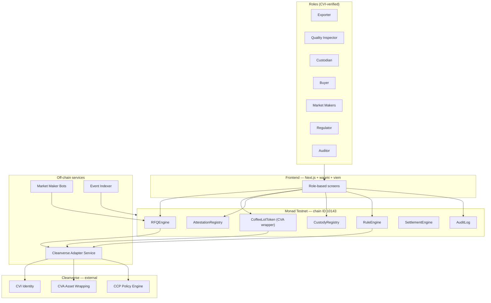

# CoffeeRFQ — Overall Architecture

**Cleanverse Build: Trusted Assets Hackathon — RWA Track**

This document is the system-level map. For depth on any one layer, see the companion docs: `02_RFQ_Engine_and_Pricing.md`, `03_Tech_Stack.md`, `04_Smart_Contracts_Architecture.md`, `05_Screen_Designs.md`.

---

## System summary

CoffeeRFQ is a compliant settlement layer for a physical commodity (coffee) built on Monad. A verified exporter mints a CVA-wrapped token representing a specific coffee lot; a verified buyer requests quotes from verified market makers rather than trading against an AMM pool; every transfer is checked against Cleanverse's compliance rules at the point of request *and* at the point of settlement; and every trade produces an audit-ready record that a regulator or auditor can pull on demand.

Six roles participate, each scoped to specific on-chain actions via Cleanverse's CVI (identity) layer: **Exporter, Quality Inspector, Custodian, Buyer, Market Maker, Regulator/Auditor.**

---

## Component diagram

---

## Component responsibilities

| Layer | Component | Responsibility |
|---|---|---|
| On-chain | `AttestationRegistry` | Stores Quality Inspector grade attestations, required before minting |
| On-chain | `CustodyRegistry` | Tracks physical custody state per lot |
| On-chain | `RuleEngine` | Stores Regulator-defined jurisdiction rules, flags, freezes |
| On-chain | `CoffeeLotToken` | CVA-wrapped commodity token; enforces transfer eligibility |
| On-chain | `RFQEngine` | Request → quote → accept lifecycle |
| On-chain | `SettlementEngine` | Atomic trade execution, internal-only |
| On-chain | `AuditLog` | Immutable trade history, Travel Rule data |
| Off-chain | Market Maker Bots | Listen for RFQ events, submit priced quotes |
| Off-chain | Event Indexer | Mirrors on-chain state for the UI without a subgraph |
| Off-chain | Cleanverse Adapter | Bridges contract calls to CVI/CVA/CCP endpoints |
| External | Cleanverse (CVI / CVA / CCP) | Identity, asset wrapping, and policy — not reimplemented locally |

---

## Data flow, end to end

1. Quality Inspector signs a grade attestation for a lot.
2. Exporter mints `cvCOFFEE` — blocked without a valid attestation on file.
3. Custodian updates custody status independently, at any point after mint.
4. Buyer submits an RFQ; visible only to CVI-verified market makers.
5. Market makers respond with signed, time-boxed quotes.
6. Buyer accepts the best quote → triggers a compliance check against Regulator-defined rules.
7. Settlement executes atomically on Monad; a second compliance check runs at the token-transfer level.
8. `AuditLog` records the trade with Travel Rule data attached.
9. Regulator or Auditor pulls the audit trail on demand — read-only, no trade participation.

Full mechanics of step 4–7 are in `02_RFQ_Engine_and_Pricing.md`. Contract-level detail for every step is in `04_Smart_Contracts_Architecture.md`.

---

## Cross-cutting concern: compliance is checked twice

Every transfer-eligible action is checked once at the **RFQ layer** (`acceptQuote`) and again at the **token layer** (`CoffeeLotToken._beforeTransfer`). This isn't redundant — it's what makes `flagWallet()` / `freezeLot()` actually enforceable everywhere a transfer could happen, not just at the moment a quote is accepted. Any future action that moves the token needs to go through the same token-layer check, by construction.

---

## External dependencies and open assumptions

- Cleanverse's CVI/CVA/CCP integration is treated as an external interface (`ICleanverseCVI`, `ICleanverseCVA`) rather than reimplemented. No public API/SDK spec is available yet, so contracts are built and tested against a mocked interface first, then pointed at the real hackathon sandbox endpoint once available.
- Physical-world facts (grade accuracy, actual custody, real regulator identity) are represented by role-gated attestations, not independently verified — this matches how Cleanverse's own production model works, and is stated explicitly in the demo rather than implied as solved.
