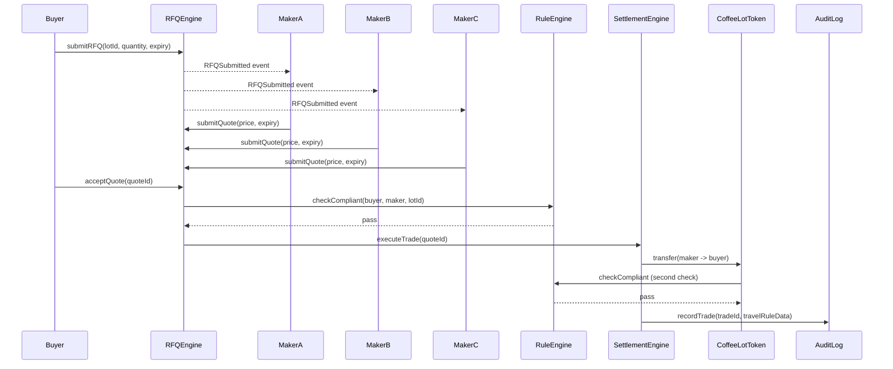

# CoffeeRFQ — RFQ Engine & Pricing Logic

Detail on the request → quote → accept → settle lifecycle, and the pricing model used by market maker bots in the hackathon demo. See `04_Smart_Contracts_Architecture.md` for the contract-level function signatures this document assumes.

---

## Why RFQ instead of an AMM

Coffee-token liquidity will always be thin — there is no realistic path to a deep on-chain pool for a specific harvest lot. Pricing that off a bonding curve produces slippage no real exporter or roaster would accept for a container-sized trade. RFQ instead lets market makers price off their own inventory model and quote directly, which is closer to how physical commodities are actually priced OTC today.

---

## RFQ lifecycle states

| State | Meaning | Transition trigger |
|---|---|---|
| `Open` | RFQ submitted, visible to verified makers | `submitRFQ()` |
| `Quoted` | One or more quotes received | `submitQuote()` |
| `Accepted` | Buyer has accepted a quote | `acceptQuote()` |
| `Settled` | Trade executed, tokens and payment transferred | `executeTrade()` completes |
| `Expired` | RFQ window passed with no acceptance | expiry timestamp reached |

A quote itself carries its own shorter expiry (30–60 seconds), independent of the RFQ's own window — a maker's quote can expire even while the RFQ is still open for other makers to respond.

---

## Sequence diagram — one full RFQ cycle



---

## Quote validity and expiry handling

- Each quote carries an `expiry` timestamp set by the maker at submission (30–60 seconds out, matching how live RFQ networks operate elsewhere in DeFi).
- `acceptQuote()` reverts if `block.timestamp > quote.expiry` — an expired quote cannot be accepted even if it's still the best price on record.
- If the buyer's accept transaction lands after expiry due to network delay, the revert is the correct behavior, not a bug — this mirrors the "last look" tension inherent to RFQ systems generally, and is worth naming explicitly in the demo rather than treating as an edge case to hide.
- If no quotes are received before the RFQ's own (longer) expiry, the RFQ simply lapses to `Expired` — no special handling needed beyond a state check.

---

## Pricing model for market maker bots

The hackathon demo does not need production-grade pricing — it needs pricing that's *legible*, so judges can see the mechanism working. A simple inventory-skew model:

```
quotedPrice = referencePrice × (1 + baseSpread + inventorySkew)

inventorySkew = (requestedQuantity / makerInventory) × skewFactor
```

- `referencePrice` — a hardcoded or lightly-randomized reference price per bot, standing in for a real commodity price feed
- `baseSpread` — a fixed markup (e.g. 1–2%) representing the maker's margin
- `inventorySkew` — grows as the requested quantity approaches a larger share of the maker's simulated inventory, so a bot quoting against most of its holdings prices less aggressively than one with ample inventory

Running 2–3 bots with different `referencePrice`, `baseSpread`, and simulated inventory levels is enough to produce genuinely different quotes per RFQ — which is what makes "best quote selected" a real selection rather than a scripted outcome.

---

## Best-quote selection logic

- The buyer is shown all non-expired quotes ranked by price (lowest ask wins, since the buyer is purchasing).
- Selection is manual in the demo — the buyer clicks "accept" on a specific quote — rather than auto-accepting the lowest price, since a real buyer might weigh maker reputation or fill reliability. Auto-accept-lowest is a reasonable v2 feature to mention but not build.

---

## Edge cases worth handling explicitly

| Case | Handling |
|---|---|
| No quotes received before RFQ expiry | RFQ transitions to `Expired`, no trade occurs |
| Quote expires before buyer accepts | `acceptQuote()` reverts; buyer must pick a different (still-valid) quote |
| Two makers submit near-identical prices | No special tie-break needed — buyer picks manually |
| Lot gets frozen by Regulator mid-RFQ | `submitQuote()` and `acceptQuote()` both check `RuleEngine` state and revert if frozen |
| Buyer tries to accept a quote for someone else's RFQ | `acceptQuote()` checks `msg.sender == rfq.buyer`, reverts otherwise |
| Maker submits a quote below their simulated inventory but above requested quantity | Out of scope for the hackathon demo — no partial-fill logic; quotes are all-or-nothing on the full requested quantity |

---

## What's deliberately out of scope

Real price-feed integration, partial fills, quote cancellation before expiry, and maker reputation scoring are all reasonable production features that add complexity without adding to the "depth of integration" story judges are scoring. Naming them here as acknowledged-but-cut is stronger than building a half version of any of them.
