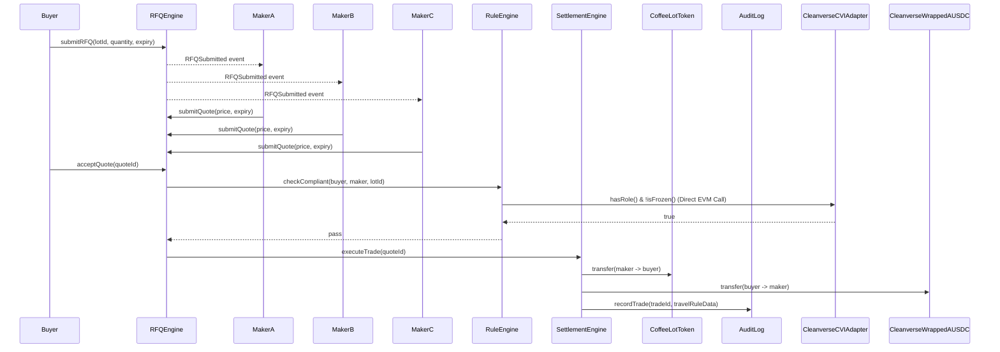

# CoffeeRFQ — RFQ Engine & Pricing Logic

Detail on the request → quote → accept → settle lifecycle, and the pricing model used by market maker bots in the hackathon demo. See `04_Smart_Contracts_Architecture.md` for the contract-level function signatures this document assumes.

---

## Why RFQ instead of an AMM

Coffee-token liquidity will always be thin — there is no realistic path to a deep on-chain pool for a specific harvest lot. Pricing that off a bonding curve produces slippage no real exporter or roaster would accept for a container-sized trade. RFQ instead lets market makers price off their own inventory model and quote directly, which is closer to how physical commodities are actually priced OTC today.

---

## RFQ lifecycle states

| State | Meaning | Transition trigger |
|---|---|---|
| `Open` | RFQ submitted, visible to verified makers | `submitRFQ()` |
| `Quoted` | One or more quotes received | `submitQuote()` |
| `Accepted` | Buyer has accepted a quote | `acceptQuote()` |
| `Settled` | Trade executed, tokens and payment transferred | `executeTrade()` completes |
| `Expired` | RFQ window passed with no acceptance | expiry timestamp reached |

A quote itself carries its own shorter expiry (30–60 seconds), independent of the RFQ's own window — a maker's quote can expire even while the RFQ is still open for other makers to respond.

---

## Sequence diagram — one full RFQ cycle



---

## Compliance Gating Architecture (Option A Implemented)

Compliance gating uses **Option A: Direct On-Chain EVM Reads** against `CleanverseCVIAdapter.sol` deployed at `0x1c5fa313efc3868e0396532f92c163c02c148d6d` on Monad Testnet.

- `acceptQuote()` invokes `RuleEngine.checkCompliant(buyer, maker, lotId)`.
- `RuleEngine` queries `cvi.hasRole()` and `!cvi.isFrozen()` synchronously during the transaction execution.
- If a counterparty is frozen or lacks the required CVI role, the transaction reverts synchronously with `NotAuthorized()`, `LotFrozen()`, or `NonCompliant()`.

---

## Pricing model for market maker bots (Fixed Direction)

Market maker bots compute competitive quotes based on standard commodity inventory-skew economics:

```
P_quote = RefPrice × (1 + BaseSpread) × (1 + SkewFactor × (TargetInventory − CurrentInventory) / TargetInventory)
```

### Economic Behavior & Sign Dynamics:
- **High Inventory (`CurrentInventory > TargetInventory`):** Skew term is negative $\rightarrow$ Maker quotes **lower / cheaper** to incentivize buyers and unload excess warehouse stock (e.g. Market Maker Beta @ $7.90/kg vs $8.15/kg baseline).
- **Balanced Inventory (`CurrentInventory == TargetInventory`):** Skew term is 0 $\rightarrow$ Maker quotes baseline market price (e.g. Market Maker Alpha @ $8.15/kg).
- **Low Inventory (`CurrentInventory < TargetInventory`):** Skew term is positive $\rightarrow$ Maker quotes **higher / premium** to conserve remaining stock (e.g. Market Maker Gamma @ $8.45/kg).

---

## Multi-Factor Quote Selection Logic

Selection in the demo is manual — the buyer weighs multiple quantitative factors alongside price:
1. **Quoted Unit Price ($/kg and $/lb)**
2. **Historical Settlement Fill Rate (%)** (e.g., Maker Beta: 99.6% vs Maker Gamma: 95.5%)
3. **Execution Latency (Seconds)** (e.g., Maker Beta: 0.8s vs Maker Gamma: 2.5s)
4. **Inventory Rationale & Expiry Countdown**

---

## Edge Cases Demonstrated Live

| Scenario | Expected Behavior | Live Demo Trigger |
|---|---|---|
| Quote expires before buyer accepts | `acceptQuote()` reverts; UI greys out quote | `[ ⏱ Expire Quote ]` in simulation drawer |
| Lot / Wallet frozen mid-RFQ (Regulator action) | `submitQuote()` and `acceptQuote()` revert with `LotFrozen() / NonCompliant()` | `[ 🔴 Simulate Frozen Wallet ]` in simulation drawer |
| Buyer accepts another buyer's quote | `acceptQuote()` checks `msg.sender == rfq.buyer`, reverts | Enforced natively by smart contract |
| No quotes received | RFQ lapses to `Expired` | Expiry countdown timer reaches 0 |

---

## What's Real vs. Simulated

- **Real:** AUSDC balances and transfers on Monad Testnet (`0x534b2f3A21130d7a60830c2Df862319e593943A3`), `CleanverseCVIAdapter` role checks (`0x1c5f...8d6d`), on-chain RFQ state transitions, atomic DvP settlement, and TR-88391 audit log records.
- **Simulated:** Warehouse inventory numbers (`15,000 kg`, `8,000 kg`) — demo-seeded parameters for bot pricing algorithms.
- **Deliberately Out of Scope:** Partial-fill executions (all-or-nothing on full lot size) and market maker self-registration.
