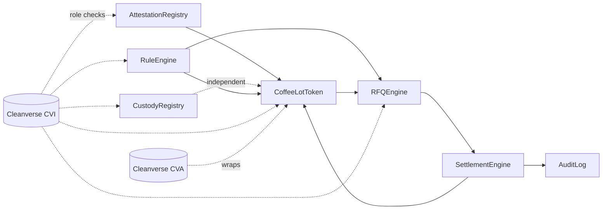

# CoffeeRFQ — Smart Contracts Architecture

Design-level spec — pseudocode function signatures, not implementation. Built for Monad (full EVM compatibility, standard Solidity applies directly).

---

## Contract map

| Contract | Owns | Depends on |
|---|---|---|
| `CoffeeLotToken` | The `cvCOFFEE` asset itself | Cleanverse CVA (wrapping), CVI (transfer gating) |
| `AttestationRegistry` | Quality Inspector attestations | CVI (role gate) |
| `CustodyRegistry` | Custodian status per lot | CVI (role gate) |
| `RuleEngine` | Regulator's jurisdiction rules, flags, freezes | CVI (role gate) |
| `RFQEngine` | Request → quote → accept lifecycle | `CoffeeLotToken`, `RuleEngine`, CVI |
| `SettlementEngine` | Atomic trade execution | `RFQEngine`, `CoffeeLotToken` |
| `AuditLog` | Trade history, Travel Rule data | Written by `SettlementEngine`, read by Auditor |

---

## Contract relationship diagram



---

## External interfaces (assumed shape)

Cleanverse's CVI and CVA are treated as external systems, not reimplemented. No public API/SDK spec exists yet, so this is the *shape* to design against, swapped for real signatures once sandbox docs are available:

```
ICleanverseCVI {
  hasRole(address wallet, bytes32 role) returns (bool)
  isFrozen(address wallet) returns (bool)
}

ICleanverseCVA {
  wrapAsset(bytes32 lotId, uint256 amount, bytes metadata) returns (uint256 tokenId)
  isTransferEligible(address from, address to, uint256 tokenId) returns (bool)
}
```

Every contract that gates by role calls `ICleanverseCVI.hasRole()` rather than keeping its own role table — CVI stays the single source of truth for identity.

---

## Core data structures

```
struct Lot {
  bytes32 lotId
  address exporter
  uint256 quantity
  bytes32 gradeAttestationId   // must be non-zero to mint
  CustodyStatus custodyStatus
  bool frozen
}

struct RFQ {
  bytes32 rfqId
  address buyer
  bytes32 lotId
  uint256 quantity
  uint256 expiry
  RFQStatus status            // Open, Quoted, Accepted, Settled, Expired
}

struct Quote {
  bytes32 quoteId
  bytes32 rfqId
  address maker
  uint256 price
  uint256 expiry
  bool accepted
}

struct Trade {
  bytes32 tradeId
  bytes32 quoteId
  address buyer
  address maker
  uint256 settledAt
  bytes travelRuleData
}
```

---

## Function signatures by contract

**AttestationRegistry** (Quality Inspector)
```
signGradeAttestation(lotId, grade, notes)   — onlyRole(QUALITY_INSPECTOR)
getAttestation(lotId) view
```

**CustodyRegistry** (Custodian)
```
updateCustodyStatus(lotId, status)          — onlyRole(CUSTODIAN)
getCustodyStatus(lotId) view
```

**RuleEngine** (Regulator)
```
setJurisdictionRule(ruleId, params)         — onlyRole(REGULATOR)
flagWallet(address wallet)                  — onlyRole(REGULATOR)
freezeLot(lotId)                            — onlyRole(REGULATOR)
unfreeze(lotId)                             — onlyRole(REGULATOR)
checkCompliant(walletA, walletB, lotId) view  // called by RFQEngine + CoffeeLotToken
```

**CoffeeLotToken** (CVA wrapper — ERC-1155-style; lotId as token id, quantity as balance)
```
mintLot(lotId, quantity, metadata)          — onlyRole(EXPORTER)
                                               requires AttestationRegistry.getAttestation(lotId) != 0
_beforeTransfer(from, to, lotId)            — checks CVI.hasRole + RuleEngine.checkCompliant
                                               reverts if either fails
```

**RFQEngine**
```
submitRFQ(lotId, quantity, expiry)          — onlyRole(BUYER)
submitQuote(rfqId, price, expiry)           — onlyRole(MARKET_MAKER)
                                               requires lot not frozen
acceptQuote(quoteId)                        — onlyRole(BUYER)
                                               must be original RFQ requester
                                               reverts if quote expired
                                               → calls RuleEngine.checkCompliant()
                                               → calls SettlementEngine.executeTrade()
```

**SettlementEngine**
```
executeTrade(quoteId)                       — internal, called only by RFQEngine.acceptQuote
                                               transfers cvCOFFEE (maker → buyer) and
                                               stablecoin (buyer → maker) atomically
                                               → calls AuditLog.recordTrade()
```

**AuditLog**
```
recordTrade(tradeId, details)               — internal, called only by SettlementEngine
getAuditTrail(tradeId) view                 — onlyRole(AUDITOR) or onlyRole(REGULATOR)
```

---

## Call flow, mapped to the trade lifecycle

1. Quality Inspector → `AttestationRegistry.signGradeAttestation()`
2. Exporter → `CoffeeLotToken.mintLot()` — reverts without an attestation on file
3. Custodian → `CustodyRegistry.updateCustodyStatus()` — independent, callable anytime after mint
4. Buyer → `RFQEngine.submitRFQ()`
5. Market Makers → `RFQEngine.submitQuote()` × N
6. Buyer → `RFQEngine.acceptQuote()` → `RuleEngine.checkCompliant()` → `SettlementEngine.executeTrade()` → `CoffeeLotToken._beforeTransfer()` (second check) → `AuditLog.recordTrade()`
7. Auditor / Regulator → `AuditLog.getAuditTrail()`

---

## Design decisions worth flagging

- **Compliance is checked twice** — once in `RFQEngine.acceptQuote()`, again inside `CoffeeLotToken._beforeTransfer()`. Intentional: it's what makes `freezeLot()` / `flagWallet()` enforceable everywhere a transfer could happen, not just at the RFQ layer.
- **ERC-1155 over ERC-20** — each lot is a distinct token id with its own quantity, matching "500 bags of a specific harvest" far better than a fungible pool would.
- **`SettlementEngine` and `AuditLog` have no external-facing write functions** — only callable internally by `RFQEngine`, which prevents the trade lifecycle from being triggered out of order.
- **Hackathon cut, if time runs short:** collapse `AttestationRegistry`, `CustodyRegistry`, and `RuleEngine` into a single `RoleRegistry` contract with separate mappings — fewer deployments, same functional coverage. Only worth doing under real time pressure; keeping them separate is a cleaner architecture story for judges.
