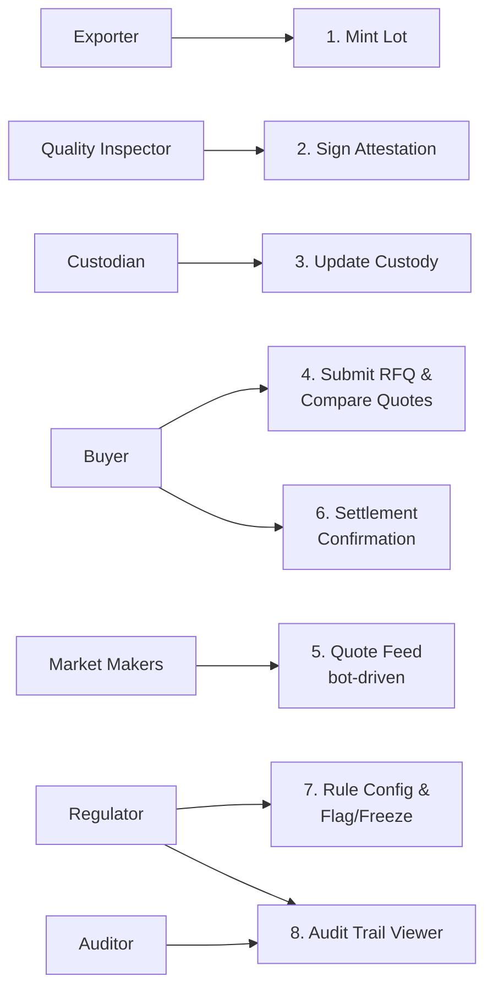

# CoffeeRFQ — Screen Designs

Eight screens, each gated to a specific role. Scope is deliberately narrow — one clean screen per role rather than a full app, sized to demo the Finca Verde / Nordlicht Roasters pilot story end to end.

---

## Role → screen map



---

## 1. Exporter — Mint Lot

**Purpose:** mint a new `cvCOFFEE` lot, blocked until a valid attestation exists.

**Key elements:** lot ID / origin / grade (read-only, pulled from attestation once signed) · quantity input · "Attestation status" badge (Pending / Signed) · Mint button, disabled until attestation is signed.

**Wireframe:**
```
┌─────────────────────────────────────────┐
│  Mint Coffee Lot                          │
├─────────────────────────────────────────┤
│  Lot ID:        FV-2026-014               │
│  Origin:        Huila, Colombia            │
│  Grade:         [pending attestation]      │
│  Quantity:      [ 500        ] bags        │
│                                             │
│  Attestation:   ● Pending                  │
│                                             │
│  [  Mint Lot  ]  (disabled until signed)   │
└─────────────────────────────────────────┘
```

**States:** no attestation (mint disabled, reason shown) · attestation signed (mint enabled) · minted (lot appears in Buyer's browsable list).

---

## 2. Quality Inspector — Sign Attestation

**Purpose:** sign the grade attestation a lot needs before it can be minted.

**Key elements:** pending-lot queue · grade input (e.g. cupping score, defect count) · free-text notes · Sign button.

**States:** unsigned (visible to Exporter as blocking) · signed (timestamp + inspector address shown, immutable).

---

## 3. Custodian — Update Custody Status

**Purpose:** reflect physical custody state independently of minting or trading.

**Key elements:** lot selector · current status badge · status transition buttons (`in-warehouse → released → in-transit → delivered`).

**States:** each transition is a distinct on-chain write; status is visible read-only on the Buyer's quote-comparison screen so a buyer can see whether a lot has actually shipped.

---

## 4. Buyer — Submit RFQ & Compare Quotes

**Purpose:** the core trading screen — request a quote, watch responses arrive, accept one.

**Key elements:** lot browser (filter by origin/grade) · RFQ submission form (quantity, expiry) · live quote list, ranked by price · countdown timer per quote showing time-to-expiry · Accept button per quote.

**Wireframe:**
```
┌─────────────────────────────────────────────────┐
│  Request Quotes — Lot FV-2026-014 (500 bags)      │
├─────────────────────────────────────────────────┤
│  Maker A    $4.85/lb   expires in 0:42   [Accept] │
│  Maker B    $4.79/lb   expires in 0:38   [Accept] │
│  Maker C    $4.91/lb   expires in 0:51   [Accept] │
├─────────────────────────────────────────────────┤
│  Best price highlighted · quotes update live       │
└─────────────────────────────────────────────────┘
```

**States:** RFQ open, no quotes yet (loading state) · quotes arriving · quote expired (grayed out, un-clickable) · quote accepted (transitions to Settlement Confirmation).

---

## 5. Market Maker — Quote Feed

**Purpose:** minimal, mostly for demo transparency — since makers are bot-driven, this screen shows what the bots are doing rather than requiring manual interaction.

**Key elements:** incoming RFQ feed · bot's calculated price (showing the reference price + spread + inventory skew inputs, so judges can see the pricing logic working, not just the output) · submitted-quote log.

**Note:** can be read-only for the demo — no live human interaction required, since the bots submit automatically per `02_RFQ_Engine_and_Pricing.md`.

---

## 6. Settlement Confirmation

**Purpose:** shown to the buyer (and conceptually the maker) immediately after `acceptQuote()` triggers settlement.

**Key elements:** compliance-check result (pass/fail, with reason if failed) · transaction hash, linked to Monadscan · Travel Rule data summary · link to the audit report.

**States:** compliance pass → settled (green confirmation) · compliance fail → clear rejection reason shown (this is the screen to have ready for the "what happens when it doesn't work" demo case).

---

## 7. Regulator — Rule Configuration & Flag/Freeze

**Purpose:** define jurisdiction rules and exercise flag/freeze power.

**Key elements:** rule list (jurisdiction pairs, allowed/blocked) · add/edit rule form · wallet flag search + action · lot freeze search + action · confirmation modal before any flag/freeze (irreversible-feeling action, worth a confirm step even in a demo).

**States:** normal (no flags active) · wallet flagged (subsequent actions from that wallet shown as blocked elsewhere in the app) · lot frozen (shown as frozen on Buyer's lot browser).

---

## 8. Auditor — Audit Trail Viewer

**Purpose:** read-only view into settled trades.

**Key elements:** trade search (by lot ID, wallet, date range) · trade detail view (parties, price, timestamp, Travel Rule data, compliance-check results from both checkpoints) · export/report view.

**States:** single trade view · filtered list view. No write actions on this screen at all — reinforces that Auditor is strictly read-only, distinct from Regulator's flag/freeze power.

---

## Cross-screen notes

- **Role gating is visual, not just functional** — a wallet without the right A-Pass role shouldn't just get a disabled button, it should see a clear "requires [Role] verification" message. This is a small UI detail that reinforces the CVI story for judges without extra engineering.
- **The pilot story drives which screens get real UI polish.** Screens 1, 2, 4, and 6 are the ones the demo walks through live (Exporter mints → Inspector attests → Buyer trades → Settlement confirms). Screens 3, 5, 7, and 8 can be functionally real but visually minimal — they matter for depth of integration, not for demo narrative.
