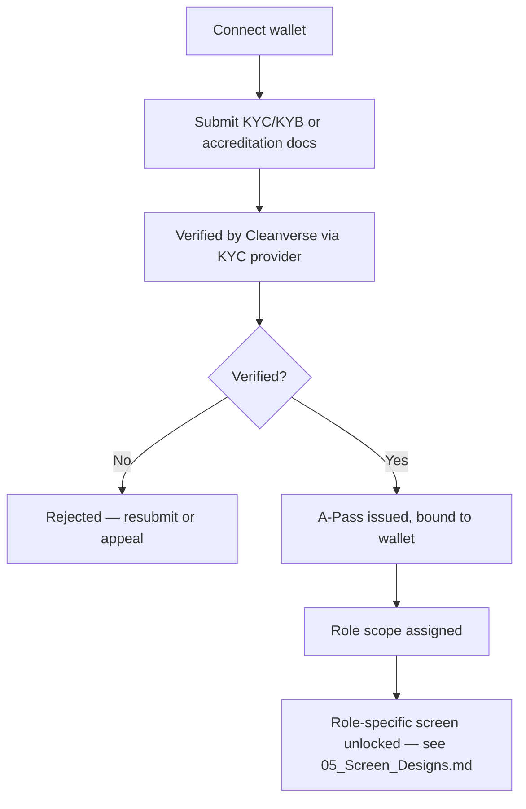
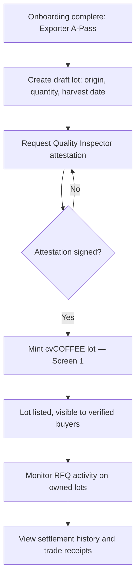
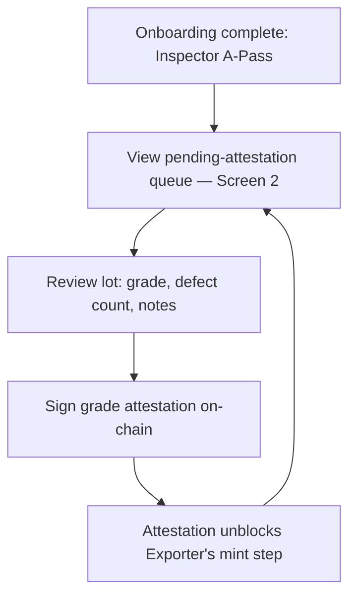
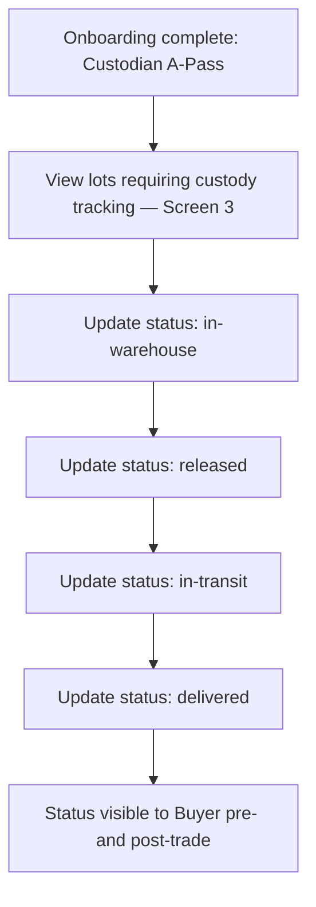
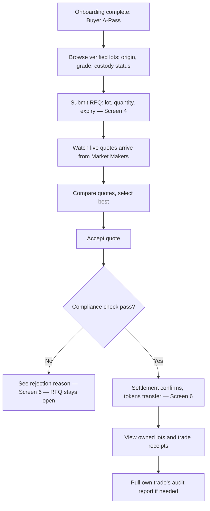
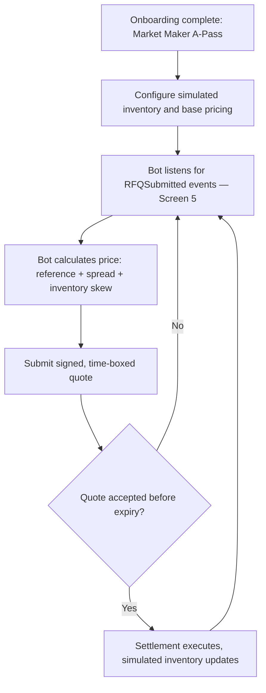
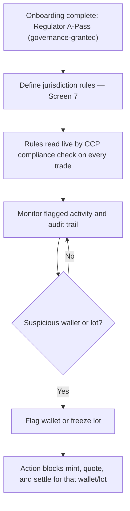
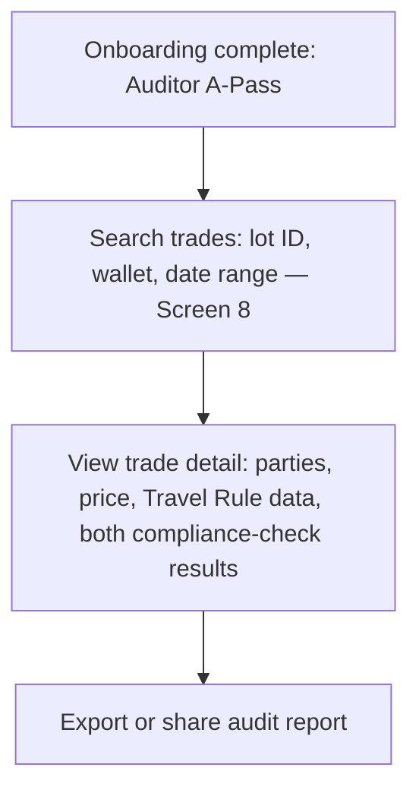

# CoffeeRFQ — Full User Flows

This is the missing piece across the other five docs: every flow so far starts *after* a wallet already holds an A-Pass. This document covers onboarding/verification first, then the complete journey for each of the seven roles — not just their slice of the trade lifecycle.

Companion docs: `01_Overall_Architecture.md` (system map), `02_RFQ_Engine_and_Pricing.md` (trade mechanics), `04_Smart_Contracts_Architecture.md` (function signatures), `05_Screen_Designs.md` (screen specs referenced below by number).

---

## 0. Onboarding — shared by every role, before anything else

No one can act in the system without an A-Pass scoped to a specific role. Verification depth differs by role type:

| Role category | Verification path | Roles |
|---|---|---|
| Individual / business KYB | ID or business registration + bank credentials, checked via a third-party KYC provider | Exporter, Buyer, Market Maker |
| Professional / business accreditation | Credential or licensing check | Quality Inspector, Custodian |
| Institutional / consortium seat | Not self-service — granted through governance, not a standard KYC form | Regulator, Auditor |

**Notes worth stating explicitly, not discovering later:**
- A single wallet can hold **multiple role-scoped A-Passes** if the entity legitimately serves more than one function (e.g. a large exporter that's also its own custodian). Each action still checks the specific role required for that action, not just "any A-Pass."
- Regulator and Auditor onboarding is **not self-service** in a real deployment — it's a governance decision, not a form submission. For the hackathon demo, this is represented as a pre-seeded role assignment rather than a built application flow (stated openly, not implied as solved).
- A-Pass expiry/renewal and rejection-appeal flows are real production concerns, explicitly out of scope for the hackathon build.

---

## 1. Exporter / Cooperative — full journey

Repeats per lot — an exporter with multiple harvests runs this loop independently for each one.

---

## 2. Quality Inspector — full journey

A queue-driven role — no ongoing monitoring after signing, just the next lot in the queue.

---

## 3. Custodian — full journey

Independent of minting or trading — custody status can update before, during, or after an RFQ cycle runs on the same lot.

---

## 4. Buyer / Importer / Roaster — full journey

This is the longest single-session journey and the one the live demo walks through end to end.

---

## 5. Market Maker — full journey

Bot-driven in the hackathon build (per `03_Tech_Stack.md`) — the "configure" step is a one-time setup per bot instance, not a per-quote human action.

---

## 6. Regulator — full journey

The Regulator never touches a trade directly — everything is exercised through rule configuration and the flag/freeze power, consistent with the non-participatory design from `04_Smart_Contracts_Architecture.md`.

---

## 7. Auditor — full journey

Strictly read-only, no write actions anywhere in this role's journey — same distinction from Regulator called out in `05_Screen_Designs.md`.

---

## Cross-role dependency summary

| This role's action... | ...blocks or unblocks | Which role it affects |
|---|---|---|
| Quality Inspector signs attestation | Unblocks minting | Exporter |
| Exporter mints lot | Unblocks lot appearing in RFQ browser | Buyer |
| Custodian updates status | Visible on lot listing, informs buyer decision | Buyer (informational, not a hard gate) |
| Regulator sets jurisdiction rule | Read live by every compliance check | Buyer, Market Maker, Exporter |
| Regulator flags/freezes | Blocks mint, quote, and settle for that wallet/lot | Exporter, Market Maker, Buyer |
| Buyer accepts a quote | Triggers settlement and audit record | Market Maker, Auditor, Regulator |

---

## What changed from the earlier trade-only flow

The diagrams built earlier in this project (the functional role-gated flow) covered steps 4–7 of the Exporter journey and step 4 of the Buyer journey only — the trade lifecycle itself. This document adds the onboarding step that precedes all of it, and the parts of each role's journey that sit outside a single trade: the Exporter's lot-monitoring loop, the Inspector's and Custodian's repeat-queue nature, the Market Maker's one-time bot configuration, and the Regulator's/Auditor's ongoing oversight loops rather than one-shot actions.
